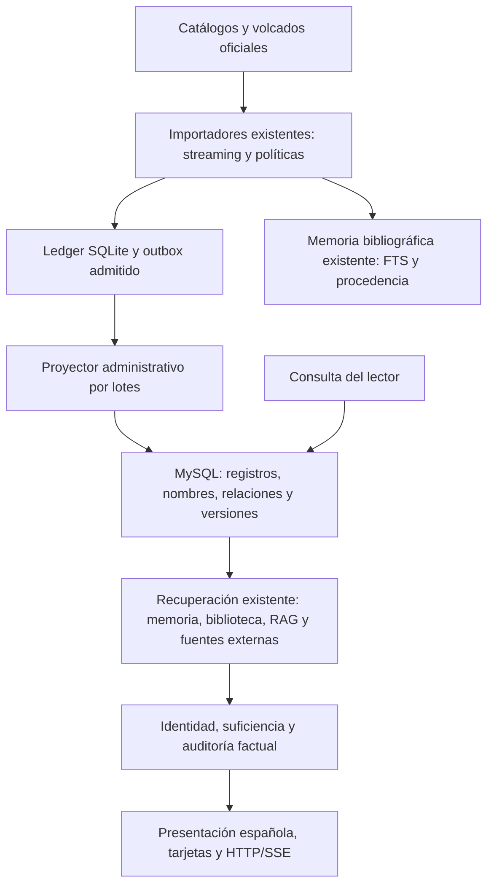

# Conocimiento bibliográfico MySQL y RAG

Primer lote implementado el 28 de octubre de 2026. No sustituye el catálogo
comercial, los datos de lectores ni los almacenes de recuperación existentes.

## Arquitectura seleccionada



MySQL mantiene registros estructurados de fuente consultables con índices B-tree.
La memoria SQLite mantiene los hechos narrativos, personajes, conflictos,
procedencia y cola de actualización que ya existían. Los índices FTS/BM25 y
vectores siguen siendo índices derivados: no son una nueva fuente factual.

El ledger es staging/outbox durable, no otro catálogo visible al usuario.
Su proyección es idempotente; las copias de metadatos en MySQL y el índice de
recuperación tienen funciones distintas. No se crea una entidad nueva por cada
pregunta ni se mezclan afirmaciones de distintas fuentes bajo una URL común.

## Auditoría de lo que ya existía

- `core.models.Libro`: título, autor, ISBN, Google ID, editorial, idioma y sinopsis;
  mezcla información de obra y edición. Mantiene 55 libros y sus relaciones de
  lectores; no se reutilizó para insertar masivamente metadatos.
- `literary_acquisition`: parser TSV Open Library y MARCXML BNE; registros de autor,
  obra y edición, relaciones por claves, historial, checkpoints y outbox.
- `literary_gutenberg`: CSV/RDF oficial, límites, reanudación y permiso exclusivo
  de metadatos. El catálogo comprimido ya estaba en disco: 5.597.116 bytes.
- `literary_memory`: obras, alias, entidades de personajes, fuentes, afirmaciones,
  conflictos, historial, FTS, trabajos y uso agregado. El piloto observó 2.256
  obras catalogadas, 842 autores normalizados, 2.388 fuentes vigentes, siete obras
  con descripciones admitidas y 37 personajes vinculados a tres obras.
- `literary_knowledge` y biblioteca: fichas originales y textos autorizados,
  búsqueda léxica/semántica, procedencia y revocación. No se recrearon.
- `literary_learning`: prioridades, cola con leases, reintentos acotados y orden
  de proveedores según señales agregadas. No entrena pesos de Qwen.

## Cinco tablas nuevas, sin modificar las anteriores

La migración `core.0008_bibliographic_repository` contiene sólo cinco CreateModel:

| Modelo | Función |
| --- | --- |
| `KBRecord` | Registro por proveedor e identificador externo, tipo, metadatos mínimos, checksum, derechos, estado y fechas |
| `KBName` | Nombres y alias normalizados indexados, siempre vinculados a un registro |
| `KBRelation` | Autoría mediante IDs de autor, edición de una obra e ISBN; admite destinos aún no importados |
| `KBVersion` | Versiones de metadatos y revisiones administrativas; no reemplaza ni borra las anteriores |
| `KBProjection` | Cursor transaccional, contadores, exclusión de proyectores y versión de cachés |

`KBRecord.id` es SHA256 de proveedor e ID externo. No se deduplica por título,
apellido, ISBN aislado o semejanza textual. Autores homónimos y obras con igual
título conservan registros distintos. Los alias de un registro no fusionan otros.

Obra, edición y ejemplar no son equivalentes. Open Library aporta IDs explícitos
de obras, ediciones y autores; Gutenberg identifica ebooks/manifestaciones, que
esta proyección guarda como ediciones. No inventa la obra abstracta ni un autor
canónico a partir de un nombre. Tampoco crea ejemplares físicos: LitMate no tiene
inventario de copias físicas que necesite migrarse en esta intervención.

La equivalencia entre proveedores necesita identificadores o relaciones verificadas;
todavía no se implementa fusión global automática entre catálogos. La duplicación
intencional de afirmaciones de dos fuentes no se oculta como una coincidencia segura.

## Evidencia, datos faltantes y revisiones

`source_metadata` significa metadatos admitidos de una fuente, no verdad
independientemente corroborada. `verified_at` permanece NULL en la importación.
La integridad por checksum demuestra estabilidad del lote, no la verdad de su autoría.

Se almacenan sólo campos permitidos: etiquetas, alias, claves, ISBN válidos,
idiomas, temas, editoriales, fechas catalográficas, procedencia y derechos.
No se copian sinopsis/biografías/reseñas, respuestas Qwen, conversaciones, imágenes
o texto completo con un permiso implícito de catálogo. Las descripciones y hechos
narrativos que ya estén autorizados siguen sus validadores de `literary_memory`.

Un libro puede carecer de autor importado, idioma, ISBN o enlace de obra. La
referencia no resuelta se conserva; no se rellena con una suposición. Una ficha
de metadatos puede responder autoría, pero no acredita trama, personajes, citas
ni relaciones narrativas. Los validadores y la búsqueda adicional siguen activos.

Una revisión más antigua no sustituye una observación reciente. Un cambio
contradictorio de la misma revisión queda en `conflict`; también se bloquean
ediciones vinculadas a la obra conflictiva. Repetir el registro original no
levanta la cuarentena. Una revisión nueva admitida o una revisión humana explícita
puede resolverla, conservando versiones e índices coherentes.

El comando administrativo permite listar conflictos y confirmar una versión
contra su fuente primaria. Exige `--operator-confirmed` y la URL exacta de fuente
de una versión admitida. Ese flag es una declaración humana, no una comprobación
automática ni un veredicto del LLM. Se registra fecha, versión seleccionada y tipo
de revisión; cambios posteriores no sobrescriben silenciosamente la corrección.
No existe endpoint anónimo de escritura al repositorio ni se guardan conversaciones
privadas como conocimiento global. Las demandas no resueltas siguen representándose
por obra/tipo en la cola existente; no se necesita publicar el texto del lector.

## Fuentes y restricciones

- **Open Library:** reutilizar TSV/TSV.gz oficiales para ingesta masiva. Sus APIs
  se reservan a consultas pequeñas iniciadas por personas, con identificación,
  caché y límites. Se aplica la política existente de metadatos mínimos, sin
  suponer permiso de copia para sinopsis o biografías. [API](https://openlibrary.org/developers/api),
  [volcados](https://openlibrary.org/developers/dumps),
  [licencias](https://openlibrary.org/developers/licensing).
- **Wikidata:** API oficial existente para consultas acotadas; metadatos CC0 y
  relaciones declaradas por fuente. La pertenencia P674 no demuestra el papel
  narrativo del personaje. No se descargó su enorme volcado ni se implementó un
  nuevo importador masivo Wikidata en este lote. [Acceso](https://www.wikidata.org/wiki/Wikidata:Data_access),
  [licencia](https://www.wikidata.org/wiki/Wikidata:Licensing).
- **Project Gutenberg:** su catálogo de metadatos está dedicado al dominio público
  y tiene un mecanismo autorizado de automatización. No se extrajo HTML de libros.
  El permiso del catálogo no concede automáticamente derechos sobre ebooks o
  traducciones en Chile u otros países. [Catálogo](https://www.gutenberg.org/ebooks/offline_catalogs.html),
  [automatización](https://www.gutenberg.org/policy/robot_access.html),
  [condiciones](https://www.gutenberg.org/policy/terms_of_use).
- **BNE:** reutiliza el adaptador MARCXML local y su política de metadatos; no se
  descargó otro lote real BNE. [Suministro](https://www.bne.es/es/perfiles/bibliotecarios/suministro-registros).
- **Google Books:** permanece como enriquecimiento puntual existente. No se
  habilitó ingesta masiva ni almacenamiento narrativo permanente nuevo; este
  repositorio no admite su proveedor como entrada masiva. Revisar las condiciones
  de uso, eliminación de contenido y restricciones comerciales antes de otro uso.
  [Condiciones oficiales](https://developers.google.com/books/terms).

No hay servicios de pago ni paquetes nuevos. No se utiliza SearXNG como cosechador
masivo y no se descargaron libros ni archivos de varios GB.

## Límites y reanudación

- Importadores existentes: streaming, registros acotados, checksum de fichero,
  filtros, staging y admisión previa a publicación. La admisión no se omite.
- Proyector: 100 registros por defecto, transacciones de 25, máximo 100 por
  transacción y presupuesto temporal. Cursor y registros se confirman juntos.
- Sólo se lee un prefijo de 65.537 bytes de cada fila del ledger: más de 64 KiB
  se rechaza antes de deserializar. El buffer de entrada por defecto queda
  limitado a aproximadamente 1,6 MiB, más ORM, conexiones y objetos Python.
- Un lease global evita proyectores concurrentes; un corte deja el último lote
  confirmado y permite reanudar. Si quedó un lease tras un apagado abrupto,
  esperar su expiración. Los cambios normales del productor reciben otro rowid.
- Los datos mal formados se contabilizan y no se publican. Si falla una transacción
  de destino, también retrocede su checkpoint; el siguiente intento repite el lote.
- Cuota contable predeterminada del proyector: 64 MiB; piloto: 16 MiB. Incluye
  payloads/versiones y una reserva para índices, pero **no es una cuota dura de
  archivos InnoDB**. Supervisar disco y tamaños físicos del servidor al escalar.
- La recuperación usa nombres indexados y referencias, nunca un barrido de todos
  los JSON. Si el límite oculta candidatos homónimos, se abstiene y permite
  desambiguar en lugar de elegir el primero. La memoria aporta FTS/BM25 y vectores.
- La revisión del repositorio invalida cachés de recuperación y respuestas;
  leer el índice no cuenta como una nueva verificación de la fuente.

## Operación local

Ejecutar desde la raíz con `venv`. Las herramientas solicitan contraseña oculta
y seleccionan MySQL sólo para ese proceso. No editar `.env` ni repetir el piloto
con el mismo ledger. El esquema y el lote de esta fase ya están aplicados.

```powershell
# Verificar/reanudar sólo los metadatos ya admitidos:
.\venv\Scripts\python.exe -B -m scripts.knowledge.mysql_control --project-ledger data/adquisicion/mysql_pilot_20261028.sqlite3 --backup-root backups/conocimiento_mysql_20261028_01 --output reports/knowledge_20261028/verificacion_nueva.json

# Leer conflictos, sin cambiar hechos:
.\venv\Scripts\python.exe -B -m scripts.knowledge.mysql_control --conflicts --backup-root backups/conocimiento_mysql_20261028_02 --output reports/knowledge_20261028/conflictos_nuevo.json

# Pruebas aisladas y arranque habitual:
.\venv\Scripts\python.exe -B verificar_proyecto.py core.test_bibliographic_repository
.\venv\Scripts\python.exe -B iniciar_mysql_local.py --http-desarrollo
```

Para confirmar una corrección humana, usar `--review-version ID --record-id ID
--evidence-url URL --operator-confirmed` en vez de `--conflicts`, sólo después de
revisar la fuente y conservar un respaldo actualizado. La herramienta rechaza
salidas existentes. No automatizar ese flag ni generarlo con Qwen.

Para nuevas ingestas, los comandos `adquirir_literatura` e `importar_catalogo_gutenberg`
siguen disponibles y documentados con `--help`. Primero admitir el lote en el
ledger; después proyectar a MySQL con `proyectar_catalogo_mysql`. No ejecutar
esos comandos con el `.env` remoto por accidente: el proyector rechaza destinos
distintos del MySQL local esperado.

Al proyectar un ledger ampliado, el lanzador admite `--max-records`, `--batch-size`,
`--max-seconds` y `--max-storage-mb`. Por ejemplo, comenzar con 1.000 registros,
lotes de 25 y 64 MiB contables, medir el resultado y reanudar; no aumentar todas
las cotas a la vez. `--pilot-catalog` queda reservado al primer lote nuevo de 100.

`LITMATE_STRUCTURED_KNOWLEDGE=auto` activa lecturas automáticamente sólo en
`litmate_db` local. `0` desactiva el puente en un proceso nuevo sin borrar tablas.
No revertir la migración para desactivar el lector ni restaurar automáticamente
la base antigua sobre datos nuevos. MySQL, TiDB y las copias SQLite no se sincronizan.

## Escalado progresivo y límites pendientes

Validar 100 → 1.000 → 10.000 registros en lotes pequeños, midiendo duplicados,
referencias pendientes, ambigüedad, p95, disco y RSS. Mantener un proyector,
respaldos y consultas EXPLAIN antes de subir otra escala. Para volcados grandes,
preparar particiones verificables sin descargarlas automáticamente: releer el hash
completo en cada importación es seguro pero tiene coste de I/O y puede agotar el
presupuesto. No se demostró capacidad de millones de registros en este PC.

Quedan por desarrollar y medir: equivalencias verificadas entre proveedores,
catálogos descargables Wikidata directos, panel de revisión, ranking multilingüe
y mayor cobertura narrativa con derechos evaluados. No se necesita otra base
vectorial ni entrenar el modelo para el primer lote. Recuperación, caché, memoria,
retroalimentación administrativa y entrenamiento de pesos son mecanismos distintos.
